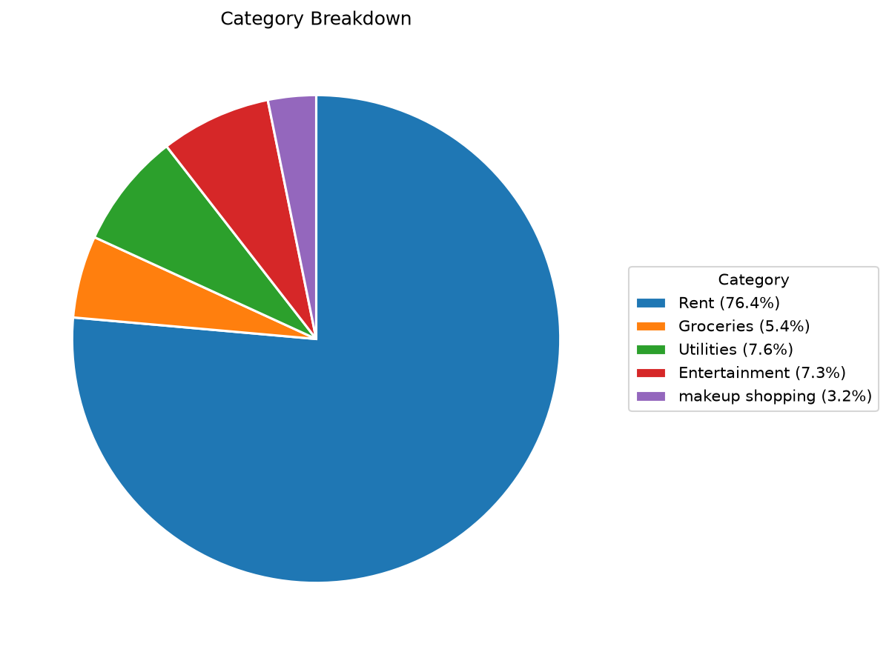

# Personal Finance Tracker

A beginner-friendly SQL project to analyze monthly spending habits and financial health.

## Features
* **Automated Categorization:** Linked transactions to categories using Foreign Keys.
* **Monthly Burn Rate:** Aggregated spending totals to track monthly outflows.
* **Savings Analysis:** Calculated net savings percentage using conditional logic.

## Data Visualization

*Visualizing category allocation from the SQL `category_breakdown` results.*

## Database Schema (EER Diagram)

*Generated via MySQL Workbench to show table relationships.*

## How to Run
1. Run `data.sql` to build the tables.
2. Run `schema.sql` to populate dummy data.
3. Execute the analysis files to see financial insights.
