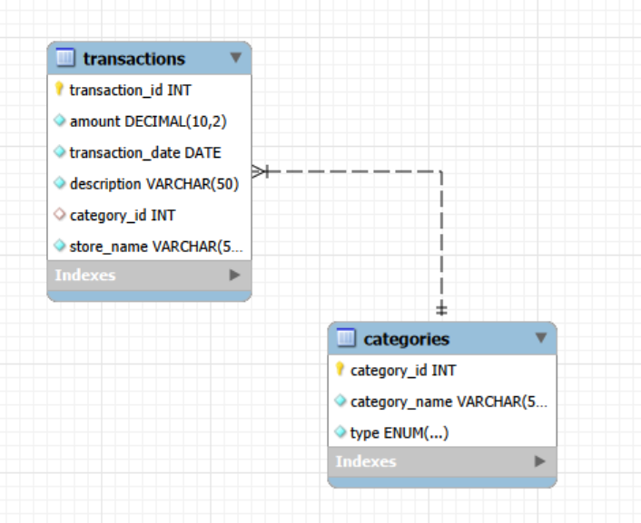

# Personal Finance Tracker (SQL)

## Project Overview
A SQL-based personal finance system designed to track income and expenses. This project demonstrates database normalization, relational mapping, and financial data analysis using MySQL.

## Core Analysis Included:
* **Monthly Burn Rate:** Calculates total outflows per month to track spending trends.
* **Category Breakdown:** Aggregates spending by category (Rent, Groceries, etc.) to show allocation percentages.
* **Savings Rate:** Implements the formula: $((Income - Expenses) / Income) * 100$.

## Database Structure
The project uses two tables linked via a **Foreign Key**:
1. `categories`: Stores the type of transaction (Income/Expense).
2. `transactions`: Stores the raw financial data, including amounts, dates, and store names.

## Key Insights

